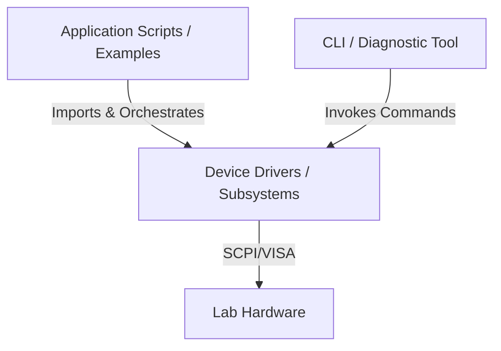

# System Architecture and Component Boundaries

This project maintains a strict boundary between three tiers of software: the **Device Drivers**, the **Command Line Interface (CLI)**, and **Application Scripts**. Separating these concerns ensures driver reusability, CLI simplicity, and script flexibility.

---

## 1. Device Drivers (The API Library)
**Location:** `src/testbench/<domain>/`

The drivers provide a clean, object-oriented Python API for interacting with the instrument's hardware subsystems, abstracted from the raw SCPI command formats.

* **Responsibilities:**
  * Transport layer management (VISA resource creation, write termination, and connection fallbacks).
  * Formatting Python types into device-specific SCPI command strings.
  * Parsing SCPI return values back into structured Python types (floats, lists, module identities).
  * Implementing hardware safety practices (e.g., ensuring relays are left open or output setpoints default to safe limits).
* **Constraints:**
  * **Stateless workflows:** Drivers must not run timing loops, manage schedules, write logs to disk, or format data for user presentation.
  * **Single-operation focus:** Functions should perform discrete, atomic tasks (e.g., setting a voltage, reading a scan list, configuring a trigger source).

---

## 2. Command Line Interface (CLI)
**Location:** `src/testbench/cli/main.py`

The CLI is a diagnostic and troubleshooting tool for human operators at the bench.

* **Responsibilities:**
  * Device discovery (`testbench discover`).
  * Basic connectivity and health checks.
  * One-off interactive adjustments (e.g., enabling/disabling a PSU output or setting a channel voltage).
  * Quick single-point measurements (e.g., reading a DMM voltage or query DAQ modules).
* **Constraints:**
  * **No looping or polling:** The CLI must not implement loops, timing intervals, or repeated sampling.
  * **No data persistence:** The CLI must not handle CSV creation, file logging, or plotting.
  * **Simple arguments:** Subcommands should take straightforward, human-readable inputs and print plain-text values or simple formats.

---

## 3. Application Scripts (Workflows)
**Location:** `examples/` and user repositories

Application scripts are where actual test automation, experiments, and workflows live.

* **Responsibilities:**
  * **Timing and looping:** Repeating measurements over time, interval sampling, sweeps, and multi-hour logging runs.
  * **Multi-instrument orchestration:** Coordinating outputs and inputs across different devices (e.g., setting a voltage on a PSU while scanning currents on a DMM).
  * **Data processing and storage:** Writing results to CSV/JSON files, computing metrics (like Max Power Point), and plotting (e.g., with Matplotlib).
  * **Error recovery:** Deciding how to handle transient hardware timeouts or experimental abort states.
* **Constraints:**
  * Scripts must use the public driver APIs rather than executing raw SCPI write/query calls directly.
  * Scripts must ensure cleanup is executed (usually via `try...finally` blocks) so instruments are left in a safe state in the event of an error.
